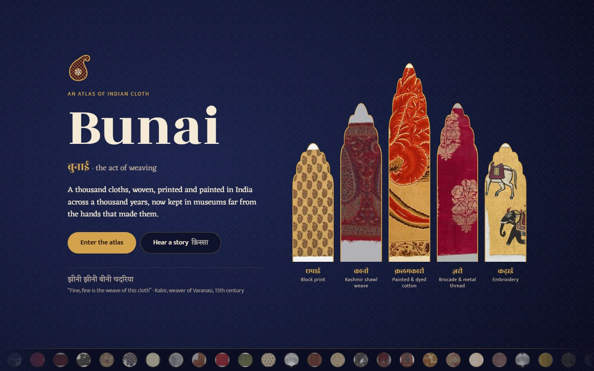
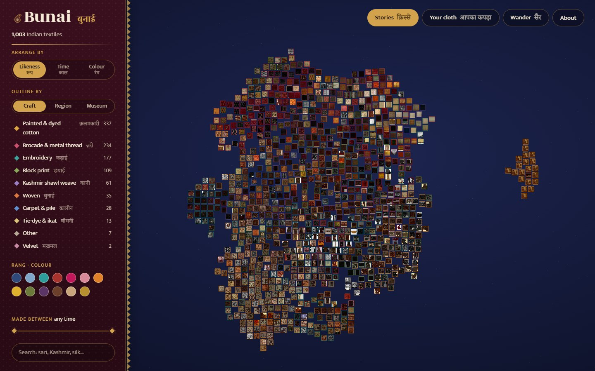
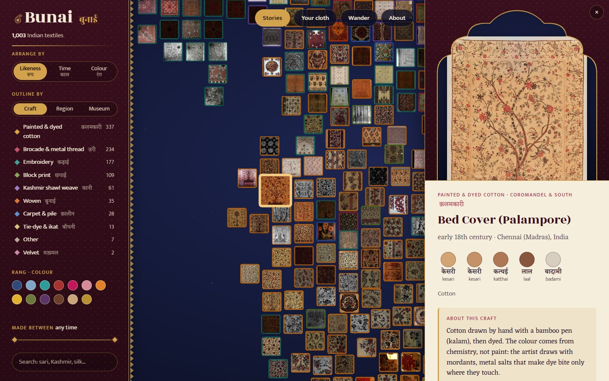
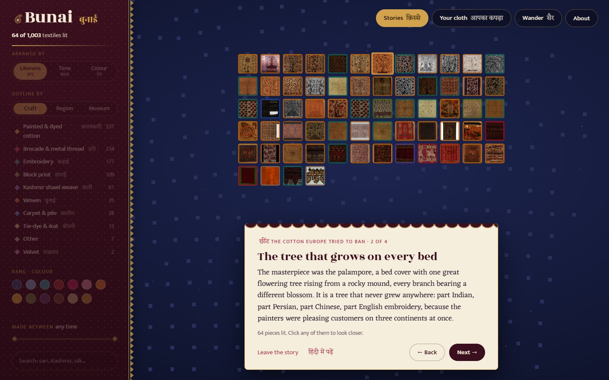
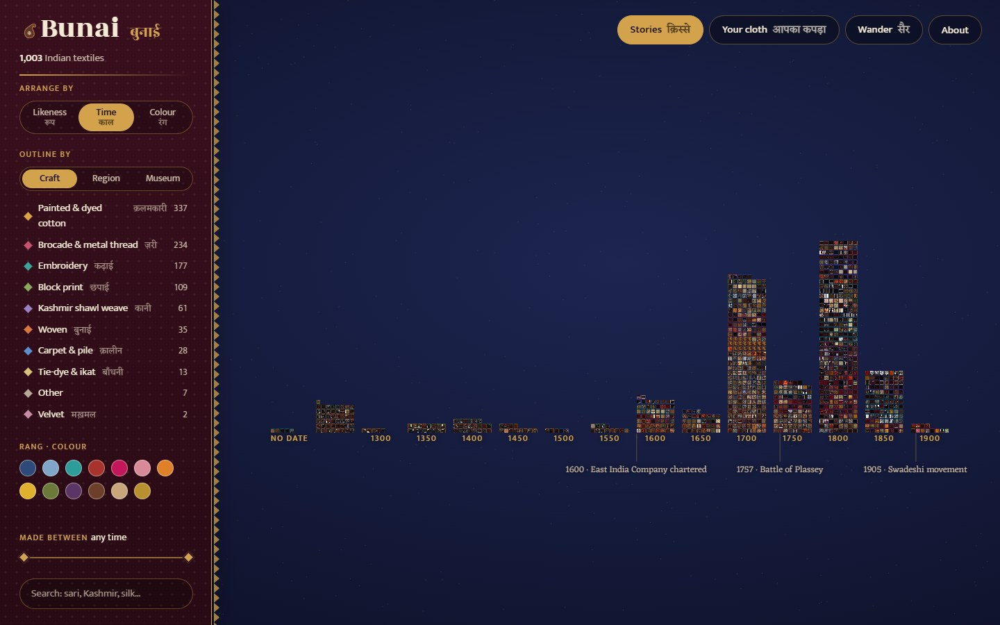
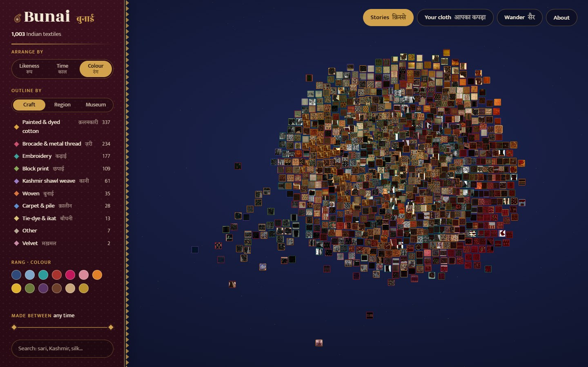

# Bunai बुनाई

An explorable atlas of historic Indian textiles. A thousand public-domain pieces from four museums, arranged by
visual likeness, by time and by colour, with guided stories told through the cloths themselves.



## A look around

| | |
|---|---|
|  |  |
| **The atlas.** Every piece placed by what it looks like. A vision model did the arranging; nobody told it what a paisley is. | **A piece.** Its date and place, its colours in the traditional dye vocabulary, how the craft works and how to spot it. |
|  |  |
| **A story.** Six guided tours, in English or Hindi. The pieces a step talks about step forward. | **By time.** Stacked by half-century. The towers show when museums were collecting, not when India wove most. |



**By colour.** Hue is the angle, vividness the distance from the centre.

## Run it

```bash
python -m venv ~/.venvs/bunai
~/.venvs/bunai/Scripts/python -m pip install torch --index-url https://download.pytorch.org/whl/cpu
~/.venvs/bunai/Scripts/python -m pip install -r requirements.txt
~/.venvs/bunai/Scripts/python pipeline/serve.py 5173
```

Then open http://localhost:5173. On macOS or Linux the interpreter is `~/.venvs/bunai/bin/python`.

The virtual environment lives outside the project on purpose: on Windows, a deep project path plus pip's own paths
can exceed the 260-character limit.

The site also works from any static file host (`web/` is self-contained). Only "Your cloth" needs `serve.py`.

## Rebuild the data

Each step reads what the one before it wrote, and each is safe to re-run.

| Step | Command | What it does |
|---|---|---|
| 1 | `python pipeline/download.py` | Fetches records and images from the Met, Cleveland, Chicago and Cooper Hewitt APIs. Keeps only items the API flags as CC0 / public domain. Skips anything already on disk. |
| 2 | `python pipeline/embed.py` | DINOv2 embedding per image (cached in `data/feats.npz`), 2D UMAP layout, nearest neighbours, colour palette, thumbnail atlas. Writes `web/data/`. |
| 3 | `python pipeline/labels.py` | Trains the craft classifier on pieces whose record names the technique, reports cross-validated accuracy, labels the rest. Must run after step 2, which resets the labels. |

Steps 2 and 3 need the virtual environment's Python. Step 1 uses only the standard library.

## How it fits together

```
pipeline/   download.py -> embed.py -> labels.py      builds the data
            serve.py                                   serves web/ and POST /api/match
data/       raw API responses, original images, embeddings, the fitted classifier   (not published)
web/        index.html, style.css                      page and visual identity
            app.js                                     map, filters, stories, upload, share card
            content.js                                 every word a visitor reads, plus sources
            logo.js, logos.html                        the mark, and a comparison sheet of the alternatives
            selftest.js                                browser smoke test
            data/                                      items.json, atlas.webp, img/
docs/       screenshots/, take-screenshots.mjs         the pictures in this README, and the script that retakes them
```

`content.js` is kept apart from the code so the writing can be fact-checked and edited without touching logic.

## Test it

Open the site, then in the browser console:

```js
(await import("./selftest.js")).run()
```

It clicks through every arrangement, filter, dialog and story step and prints a pass/fail table.

## What to know before publishing

- **Images** are CC0 from the four museums listed above. The V&A's collection is not included; its terms need permission.
- **Craft labels**: kept from the museum record where it names the technique; otherwise a model's guess, used only when
  it is at least 70% confident. `labels.py` prints the measured accuracy. Every piece records where its label came from.
- **Story text** was checked against the sources listed in the About dialog. A few claims still rest on general
  knowledge; a textile historian should read `content.js` before it goes public.
- **Hindi text** is a draft and needs a fluent editor.
- **The collection is partial**: it is what four American museums acquired, mostly court cloth, export goods and
  excavated fragments.
